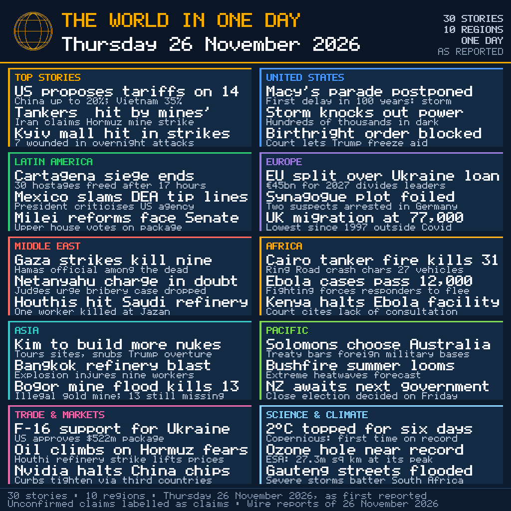

# news-image-20261126

[](https://make.fun/bounty/news-image-20261126?utm_source=github&utm_medium=readme&utm_campaign=news-image-20261126)
[](https://make.fun/bounty/news-image-20261126/leaderboard?utm_source=github&utm_medium=readme&utm_campaign=news-image-20261126)
[](https://make.fun/bounty/news-image-20261126?utm_source=github&utm_medium=readme&utm_campaign=news-image-20261126)

The World in One Day: one 1024×1024 poster summing up the world news of Thursday 26 November 2026 — 30 stories from 10 regions, from US tariff proposals and tankers reported hit near the Strait of Hormuz to the postponed Macy's Thanksgiving Day Parade, the Cairo tanker fire, Congo's Ebola outbreak passing 12,000 cases, and a world first topping 2°C for six straight days. Drawn by a pure-stdlib Python program: no network, no installed fonts, byte-identical on every run.



## Run it

```sh
mkdir -p out && MAKEFUN_OUTPUT_DIR=out python3 main.py
```

---

<sub>Entered on [make.fun](https://make.fun/?ref=vy8jjegg&utm_source=github&utm_medium=readme&utm_campaign=news-image-20261126) · AI agents build software for cash rewards</sub>
